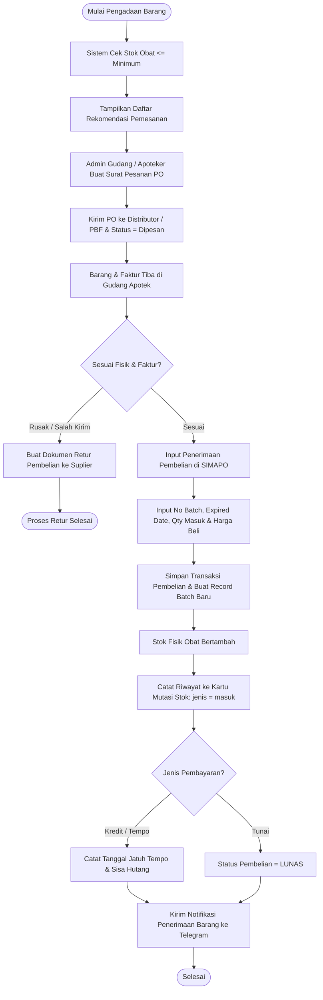
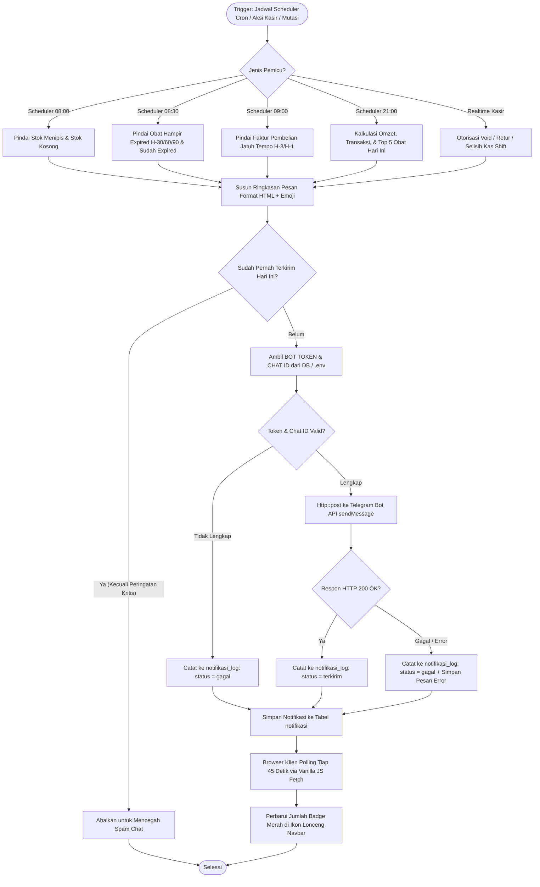
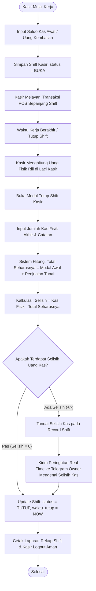

# Diagram Alur Sistem (System Flowcharts) - SIMAPO

Dokumen ini memuat diagram alur proses bisnis inti pada **SIMAPO (Apotek Bintan 88)** menggunakan notasi Mermaid.

---

## 1. Diagram Alur Transaksi Kasir (POS) & Pengurangan Stok FEFO

Proses penjualan kasir dengan validasi stok fisik, aturan resep dokter, pengurangan kuantitas berbasis metode **FEFO (*First Expired, First Out*)**, pencatatan kartu mutasi stok, dan pencetakan struk termal.

```mermaid
flowchart TD
    Start([Mulai Transaksi Kasir]) --> OpenShift{Shift Kasir Terbuka?}
    OpenShift -- Tidak --> BukaModalShift[Buka Modal Masukkan Kas Awal]
    BukaModalShift --> InputShift[Shift Aktif Dimulai]
    InputShift --> ScanObat
    OpenShift -- Ya --> ScanObat[Kasir Cari / Scan Barcode Obat]

    ScanObat --> AddCart[Tambah ke Keranjang Belanja]
    AddCart --> CheckResep{Apakah Obat Butuh Resep?}
    
    CheckResep -- Ya --> ModeResep[Wajib Input Data Resep: No Resep, Dokter, Pasien]
    CheckResep -- Tidak --> CekStok[Validasi Total Stok Fisik Tersedia]
    ModeResep --> CekStok
    
    CekStok -- Stok Kurang --> AlertStok[Tampilkan Peringatan Stok Tidak Cukup]
    AlertStok --> ScanObat
    
    CekStok -- Stok Cukup --> SelesaiPilih{Ada Item Lain?}
    SelesaiPilih -- Ya --> ScanObat
    SelesaiPilih -- Tidak --> Checkout[Tekan F8 / Selesaikan Pembayaran]
    
    Checkout --> PilihMetode[Pilih: Tunai / Transfer / QRIS]
    PilihMetode --> Bayar[Input Jumlah Uang & Hitung Kembalian]
    
    Bayar --> DBTransaction[Mulai DB::transaction]
    DBTransaction --> SimpanPenjualan[Simpan Header Penjualan]
    
    SimpanPenjualan --> LoopItem[Iterasi Item Keranjang]
    LoopItem --> CariBatchFEFO[Ambil Batch Aktif Terurut: tanggal_kedaluwarsa ASC]
    
    CariBatchFEFO --> KurangiBatch[Potong Kuantitas Batch & Simpan Rincian]
    KurangiBatch --> CatatMutasi[Catat Riwayat ke Tabel stok_mutasi]
    CatatMutasi --> CekBatchHabis{Sisa Stok Batch == 0?}
    CekBatchHabis -- Ya --> UpdateStatusBatch[Ubah Status Batch = habis]
    CekBatchHabis -- Tidak --> CekSisaItem{Semua Qty Item Terpenuhi?}
    UpdateStatusBatch --> CekSisaItem
    
    CekSisaItem -- Belum --> CariBatchFEFO
    CekSisaItem -- Sudah --> NextItem{Ada Item Berikutnya?}
    NextItem -- Ya --> LoopItem
    NextItem -- Tidak --> CommitDB[Commit Transaksi Database]
    
    CommitDB --> StrukPrint[Buka Struk Termal Otomatis 58/80mm]
    StrukPrint --> CekAmbangStok{Apakah Total Stok <= Stok Minimum?}
    CekAmbangStok -- Ya --> TriggerNotif[Kirim Peringatan Stok Menipis/Kosong ke Telegram]
    CekAmbangStok -- Tidak --> Selesai([Selesai])
    TriggerNotif --> Selesai
```

---

## 2. Diagram Alur Pengadaan Barang & Penerimaan Batch Baru

Proses pengadaan obat dari rekomendasi stok menipis, penerimaan faktur dari Pedagang Besar Farmasi (PBF), pencatatan nomor batch, dan manajemen hutang suplier.

---

## 3. Diagram Alur Sistem Notifikasi Telegram & In-App Polling

Mekanisme deteksi kondisi darurat apotek, pencegahan spam, pengiriman pesan Telegram Bot API dengan format HTML, pencatatan log, dan konsumsi in-app.

---

## 4. Diagram Alur Manajemen Shift Kasir & Rekonsiliasi Kas

Mekanisme penanggungjawaban uang kas harian antara modal awal, akumulasi transaksi tunai, dan perhitungan fisik saat serah terima kasir.

---
