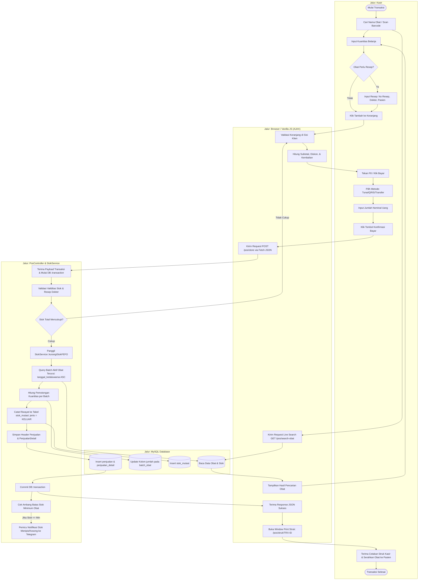
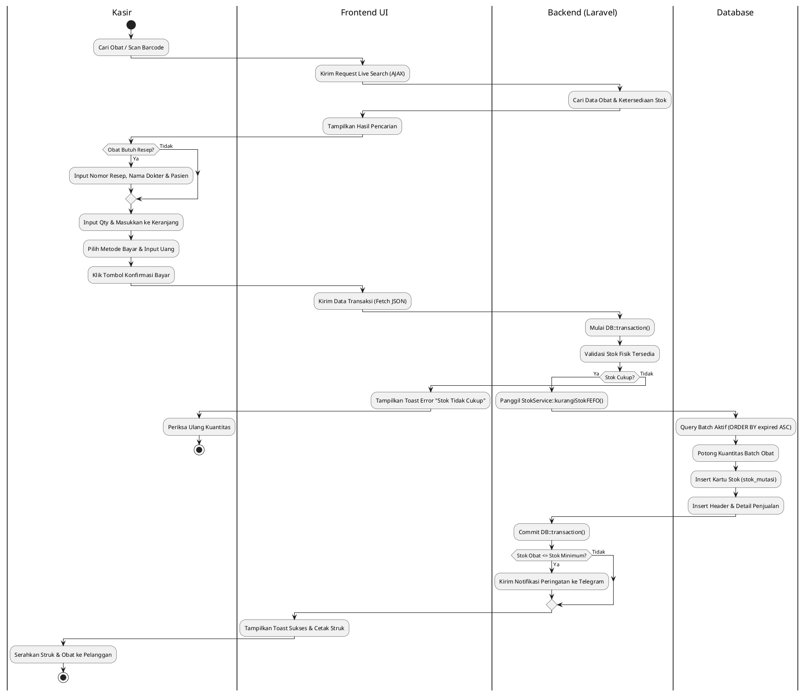
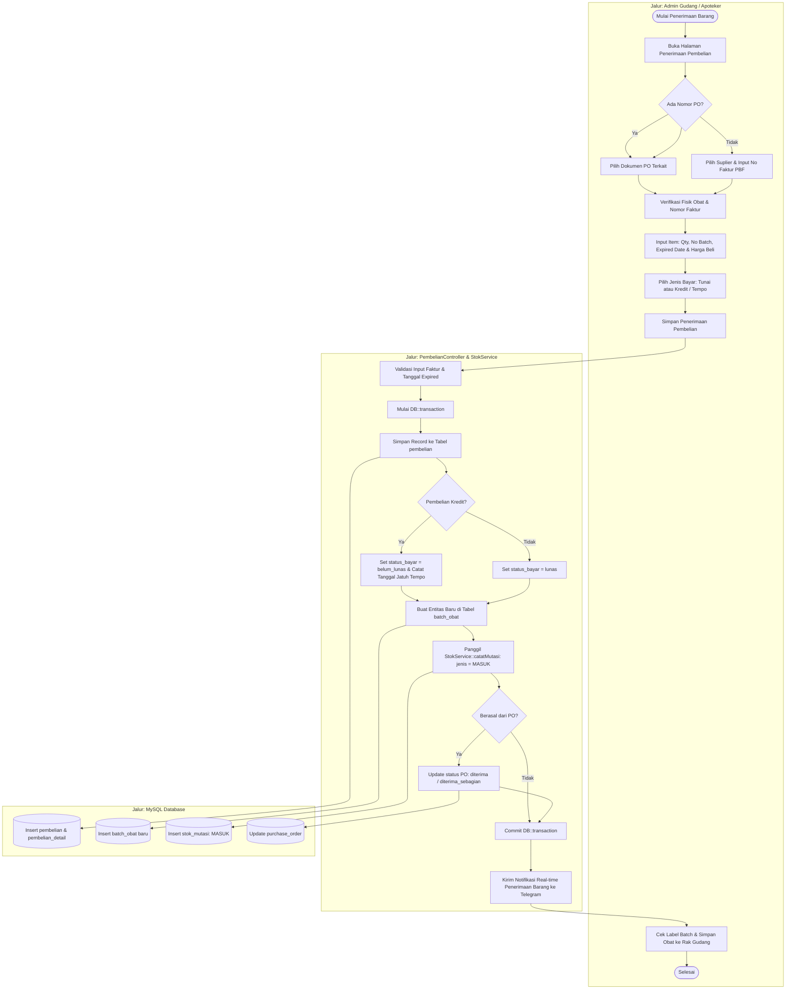
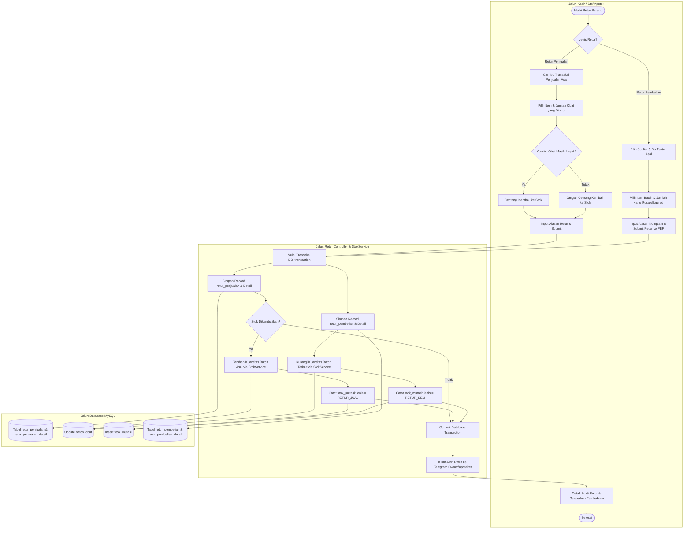
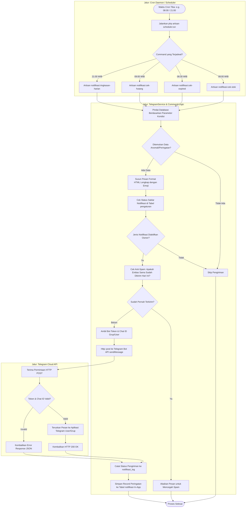
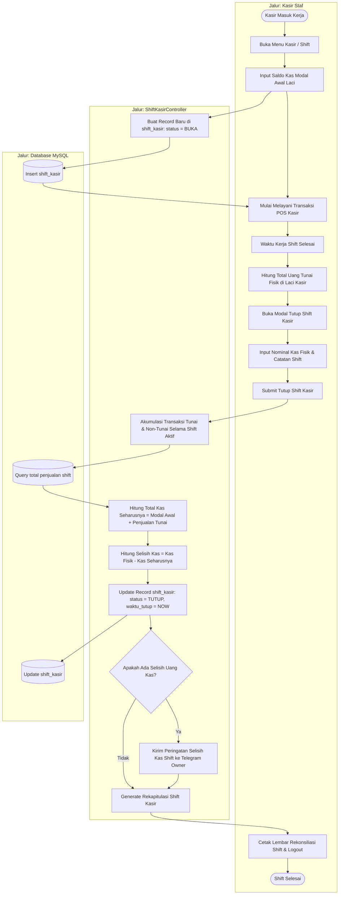

# Activity Diagram - SIMAPO (Apotek Bintan 88)

Dokumen ini memuat Activity Diagram dengan **swimlane (jalur peran/komponen)** untuk proses bisnis utama pada **SIMAPO (Apotek Bintan 88)**. Setiap diagram membagi tanggung jawab ke dalam kolom aktor/komponen:
1. **Pengguna** (Kasir / Petugas Gudang / Apoteker / Owner)
2. **Frontend UI** (Browser / Vanilla JS / DOM)
3. **Backend Service / Controller** (Laravel 13 / StokService / TelegramService)
4. **Database** (MySQL / MariaDB)

---

## 1. Activity Diagram: Transaksi Kasir POS & Pengurangan Stok FEFO

Menggambarkan alur lengkap transaksi penjualan di kasir, mulai dari pemilihan mode transaksi (bebas/resep), validasi stok fisik, pemotongan stok otomatis per batch dengan metode **FEFO (*First Expired, First Out*)**, hingga pencetakan struk kasir termal.

### Diagram Mermaid (Visual Swimlane)



### Kode PlantUML (Alternatif Swimlane Native)



---

## 2. Activity Diagram: Penerimaan Barang & Pembuatan Batch Baru

Menggambarkan alur penerimaan obat dari suplier/PBF, baik dari Purchase Order (PO) maupun faktur langsung, input nomor batch dan tanggal kedaluwarsa, pembaruan stok fisik, serta pencatatan hutang tempo.



---

## 3. Activity Diagram: Pengelolaan Retur (Retur Penjualan & Retur Pembelian)

Menggambarkan penanganan retur obat rusak/keliru: baik dari sisi pembeli (pasien) maupun pengembalian ke suplier farmasi (PBF).



---

## 4. Activity Diagram: Stock Opname & Penyesuaian Selisih Stok

Menggambarkan tahapan audit berkala stok fisik apotek, pencatatan kuantitas riil per batch, kalkulasi selisih otomatis, dan penyesuaian saldo kartu stok.

```mermaid
flowchart TD
    subgraph Apoteker ["Jalur: Apoteker / Petugas Opname"]
        A1([Mulai Stock Opname]) --> A2[Buka Menu Stock Opname & Buat Dokumen Baru]
        A2 --> A3[Pilih Kategori / Seluruh Obat yang Akan Dihitung]
        A3 --> A4[Cetak Lembar Kerja Perhitungan Fisik]
        A4 --> A5[Hitung Kuantitas Fisik Riil Obat di Rak/Lemari]
        A5 --> A6[Input Kuantitas Fisik Riil per Batch ke Sistem]
        A6 --> A7{Terdapat Selisih Stok?}
        A7 -->|Ya| A8[Wajib Mengisi Keterangan/Alasan Selisih]
        A7 -->|Tidak| A9[Verifikasi Hasil Perhitungan]
        A8 --> A9
        A9 --> A10[Klik Tombol 'Selesaikan Stock Opname']
        A13[Cetak Berita Acara Hasil Stock Opname] --> A14([Selesai])
    end

    subgraph Backend ["Jalur: StockOpnameController & StokService"]
        B1[Terima Data Opname & Buka DB::transaction]
        B2[Kalkulasi Selisih = (stok_fisik - stok_sistem)]
        B3[Simpan Record ke stock_opname & Detail]
        B4[Update Kuantitas Fisik pada batch_obat]
        B5[Catat Selisih ke stok_mutasi: jenis = PENYESUAIAN]
        B6[Kunci Status Dokumen: status = SELESAI]
        B7{Selisih Signifikan / Obat Hilang?}
        B8[Kirim Peringatan Selisih Opname ke Telegram Owner]
        B9[Commit DB::transaction]
    end

    subgraph Database ["Jalur: MySQL Database"]
        D1[(Tabel stock_opname & detail)]
        D2[(Update tabel batch_obat)]
        D3[(Insert tabel stok_mutasi)]
    end

    A10 --> B1
    B1 --> B2
    B2 --> B3
    B3 --> D1
    B3 --> B4
    B4 --> D2
    B4 --> B5
    B5 --> D3
    B5 --> B6
    B6 --> B7
    B7 -->|Ya| B8
    B7 -->|Tidak| B9
    B8 --> B9
    B9 --> A13
```

---

## 5. Activity Diagram: Pengecekan Otomatis & Notifikasi Telegram

Menggambarkan eksekusi cron job/scheduler di server untuk memeriksa stok menipis, kedaluwarsa, hutang jatuh tempo, dan pengiriman rekap penjualan malam hari.



---

## 6. Activity Diagram: Buka & Tutup Shift Kasir (Rekonsiliasi Kas Fisik)

Menggambarkan alur pertanggungjawaban uang kasir dari awal shift hingga tutup buku harian.


