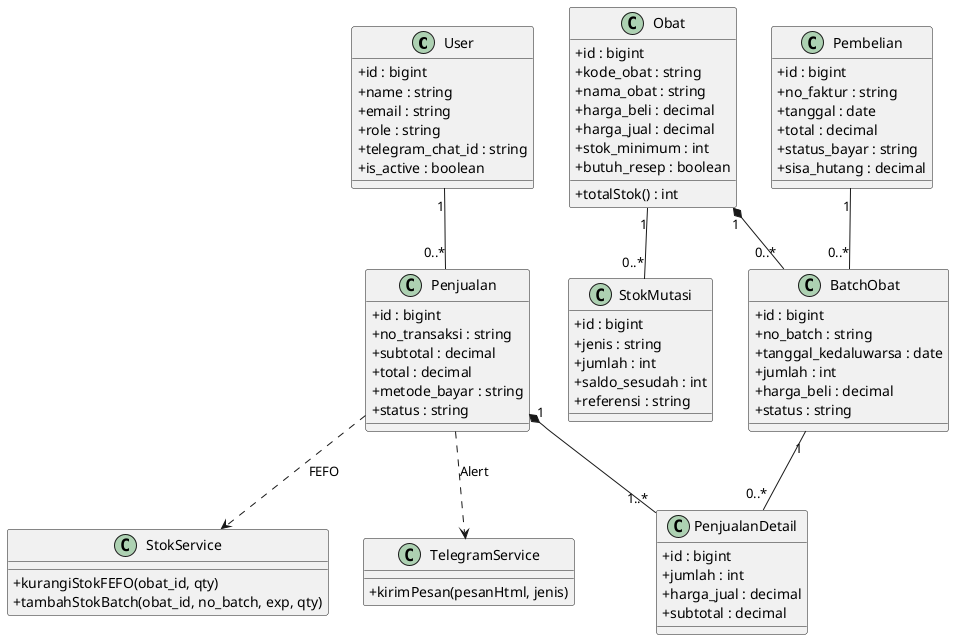

# Class Diagram - SIMAPO (Apotek Bintan 88)

Dokumen ini memuat Class Diagram untuk **SIMAPO (Apotek Bintan 88)** yang merepresentasikan struktur domain aplikasi nyata (Model Eloquent, Relasi Antar-Entitas, dan Service Layer).

---

## 1. Class Diagram Domain & Service

### Diagram Mermaid

```mermaid
classDiagram
    %% ==========================================
    %% DOMAIN ENTITIES (MODELS)
    %% ==========================================

    class User {
        +bigint id
        +string name
        +string email
        +string password
        +string role
        +string telegram_chat_id
        +boolean is_active
        +penjualan() HasMany
        +pembelian() HasMany
        +shiftKasir() HasMany
    }

    class Kategori {
        +bigint id
        +string nama
        +string deskripsi
        +obat() HasMany
    }

    class Satuan {
        +bigint id
        +string nama
        +string deskripsi
        +obat() HasMany
    }

    class Suplier {
        +bigint id
        +string nama
        +string kontak_person
        +string telepon
        +string email
        +text alamat
        +purchaseOrder() HasMany
        +pembelian() HasMany
    }

    class Dokter {
        +bigint id
        +string nama
        +string no_sip
        +string spesialis
        +string telepon
        +resep() HasMany
    }

    class Pelanggan {
        +bigint id
        +string nama
        +string telepon
        +text alamat
        +penjualan() HasMany
    }

    class Obat {
        +bigint id
        +string kode_obat
        +string nama_obat
        +string nama_generik
        +bigint kategori_id
        +bigint satuan_id
        +decimal harga_beli
        +decimal harga_jual
        +int stok_minimum
        +string lokasi_rak
        +boolean butuh_resep
        +kategori() BelongsTo
        +satuan() BelongsTo
        +batch() HasMany
        +mutasi() HasMany
        +totalStok() int
        +statusStok() string
    }

    class BatchObat {
        +bigint id
        +bigint obat_id
        +bigint suplier_id
        +string no_batch
        +date tanggal_kedaluwarsa
        +int jumlah
        +decimal harga_beli
        +string status
        +obat() BelongsTo
        +suplier() BelongsTo
        +sisaHariExpired() int
    }

    class StokMutasi {
        +bigint id
        +bigint obat_id
        +bigint batch_obat_id
        +bigint user_id
        +string jenis
        +int jumlah
        +int saldo_sebelum
        +int saldo_sesudah
        +string referensi
        +text keterangan
        +obat() BelongsTo
        +batch() BelongsTo
        +user() BelongsTo
    }

    class ShiftKasir {
        +bigint id
        +bigint user_id
        +timestamp waktu_buka
        +timestamp waktu_tutup
        +decimal modal_awal
        +decimal total_penjualan_tunai
        +decimal total_penjualan_non_tunai
        +decimal kas_akhir_aktual
        +decimal selisih_kas
        +string status
        +user() BelongsTo
        +penjualan() HasMany
    }

    class Resep {
        +bigint id
        +string no_resep
        +bigint dokter_id
        +string nama_pasien
        +int umur_pasien
        +date tanggal_resep
        +dokter() BelongsTo
        +penjualan() HasOne
    }

    class Penjualan {
        +bigint id
        +string no_transaksi
        +bigint shift_kasir_id
        +bigint user_id
        +bigint pelanggan_id
        +bigint resep_id
        +string jenis_transaksi
        +decimal subtotal
        +decimal diskon
        +decimal total
        +string metode_bayar
        +decimal bayar
        +decimal kembalian
        +string status
        +user() BelongsTo
        +pelanggan() BelongsTo
        +resep() BelongsTo
        +shift() BelongsTo
        +detail() HasMany
        +retur() HasMany
    }

    class PenjualanDetail {
        +bigint id
        +bigint penjualan_id
        +bigint obat_id
        +bigint batch_obat_id
        +int jumlah
        +decimal harga_beli
        +decimal harga_jual
        +decimal subtotal
        +penjualan() BelongsTo
        +obat() BelongsTo
        +batch() BelongsTo
    }

    class ReturPenjualan {
        +bigint id
        +string no_retur
        +bigint penjualan_id
        +bigint user_id
        +date tanggal
        +decimal total_kembali
        +text alasan
        +penjualan() BelongsTo
        +user() BelongsTo
        +detail() HasMany
    }

    class PurchaseOrder {
        +bigint id
        +string no_po
        +bigint suplier_id
        +bigint user_id
        +date tanggal
        +date estimasi_tanggal
        +decimal total_estimasi
        +string status
        +suplier() BelongsTo
        +user() BelongsTo
        +detail() HasMany
        +pembelian() HasMany
    }

    class PurchaseOrderDetail {
        +bigint id
        +bigint purchase_order_id
        +bigint obat_id
        +int jumlah_pesan
        +int jumlah_diterima
        +decimal harga_satuan
        +decimal subtotal
        +purchaseOrder() BelongsTo
        +obat() BelongsTo
    }

    class Pembelian {
        +bigint id
        +string no_faktur
        +bigint purchase_order_id
        +bigint suplier_id
        +bigint user_id
        +date tanggal
        +decimal total
        +string jenis_bayar
        +string status_bayar
        +date jatuh_tempo
        +decimal sisa_hutang
        +suplier() BelongsTo
        +user() BelongsTo
        +purchaseOrder() BelongsTo
        +detail() HasMany
        +pembayaranHutang() HasMany
    }

    class PembelianDetail {
        +bigint id
        +bigint pembelian_id
        +bigint obat_id
        +bigint batch_obat_id
        +int jumlah
        +decimal harga_beli
        +decimal subtotal
        +pembelian() BelongsTo
        +obat() BelongsTo
        +batch() BelongsTo
    }

    class PembayaranHutang {
        +bigint id
        +bigint pembelian_id
        +bigint user_id
        +date tanggal
        +decimal jumlah_bayar
        +string metode
        +pembelian() BelongsTo
        +user() BelongsTo
    }

    class StockOpname {
        +bigint id
        +string no_opname
        +bigint user_id
        +date tanggal
        +string status
        +user() BelongsTo
        +detail() HasMany
    }

    class PemusnahanObat {
        +bigint id
        +string no_pemusnahan
        +bigint obat_id
        +bigint batch_obat_id
        +bigint user_id
        +date tanggal
        +int jumlah
        +text alasan
        +string penanggung_jawab
        +obat() BelongsTo
        +batch() BelongsTo
        +user() BelongsTo
    }

    class Notifikasi {
        +bigint id
        +bigint user_id
        +string judul
        +text pesan
        +string tipe
        +string url
        +boolean is_read
        +user() BelongsTo
    }

    class NotifikasiLog {
        +bigint id
        +string jenis
        +text pesan
        +string tujuan
        +string status
        +text response_error
        +timestamp waktu
    }

    class Pengaturan {
        +bigint id
        +string key
        +text value
        +string tipe
        +string keterangan
        +getValue(key, default)$ mixed
        +setValue(key, value, tipe)$ Pengaturan
    }

    %% ==========================================
    %% SERVICE LAYER CLASSES
    %% ==========================================

    class StokService {
        +kurangiStokFEFO(obat_id, qty, referensi, keterangan) array
        +tambahStokBatch(obat_id, no_batch, exp_date, qty, harga, suplier_id) BatchObat
        +kembalikanStokBatch(batch_id, qty, referensi, keterangan) void
        +catatMutasi(obat_id, batch_id, user_id, jenis, qty, referensi, keterangan) StokMutasi
    }

    class TelegramService {
        +getBotToken() string
        +getDefaultChatId() string
        +isNotificationEnabled(jenis) bool
        +kirimPesan(pesanHtml, jenis, entitasTipe, entitasId, chatId, forceSend) array
    }

    %% ==========================================
    %% RELATIONSHIPS & CARDINALITIES
    %% ==========================================

    User "1" --> "0..*" Penjualan : mencatat
    User "1" --> "0..*" Pembelian : menerima
    User "1" --> "0..*" ShiftKasir : membuka
    User "1" --> "0..*" StokMutasi : mengoperasikan
    User "1" --> "0..*" Notifikasi : menerima notif

    Kategori "1" --> "0..*" Obat : mengelompokkan
    Satuan "1" --> "0..*" Obat : mengukur satuan
    
    Obat "1" --> "0..*" BatchObat : memiliki multi-batch
    Obat "1" --> "0..*" StokMutasi : riwayat mutasi
    Obat "1" --> "0..*" PenjualanDetail : diperjualbelikan
    Obat "1" --> "0..*" PembelianDetail : dibeli
    
    Suplier "1" --> "0..*" PurchaseOrder : ditujukan
    Suplier "1" --> "0..*" Pembelian : memasok
    Suplier "1" --> "0..*" BatchObat : asal pasokan

    Dokter "1" --> "0..*" Resep : menerbitkan
    Resep "0..1" --> "1" Penjualan : dilampirkan pada
    Pelanggan "1" --> "0..*" Penjualan : membeli

    ShiftKasir "1" --> "0..*" Penjualan : mencakup
    Penjualan "1" --> "1..*" PenjualanDetail : berisi item
    Penjualan "1" --> "0..*" ReturPenjualan : diretur
    
    BatchObat "1" --> "0..*" PenjualanDetail : terpotong FEFO
    BatchObat "1" --> "0..*" PembelianDetail : diisi kuantitas
    BatchObat "1" --> "0..*" StokMutasi : mencatat mutasi

    PurchaseOrder "1" --> "1..*" PurchaseOrderDetail : berisi item
    PurchaseOrder "0..1" --> "0..*" Pembelian : direalisasikan menjadi
    
    Pembelian "1" --> "1..*" PembelianDetail : rincian faktur
    Pembelian "1" --> "0..*" PembayaranHutang : dicicil

    StockOpname "1" --> "1..*" StockOpnameDetail : rincian fisik
    
    %% Dependency ke Services
    Penjualan ..> StokService : menggunakan logika FEFO
    Pembelian ..> StokService : menggunakan penambahan stok
    Penjualan ..> TelegramService : trigger alert void/retur
    Pembelian ..> TelegramService : trigger alert barang datang
    ShiftKasir ..> TelegramService : trigger alert selisih kas
    Pengaturan <.. TelegramService : membaca bot token & konfigurasi
    TelegramService ..> NotifikasiLog : mencatat log status
```

---

## 2. PlantUML Source Code (Alternatif Ekspor ke Word)

