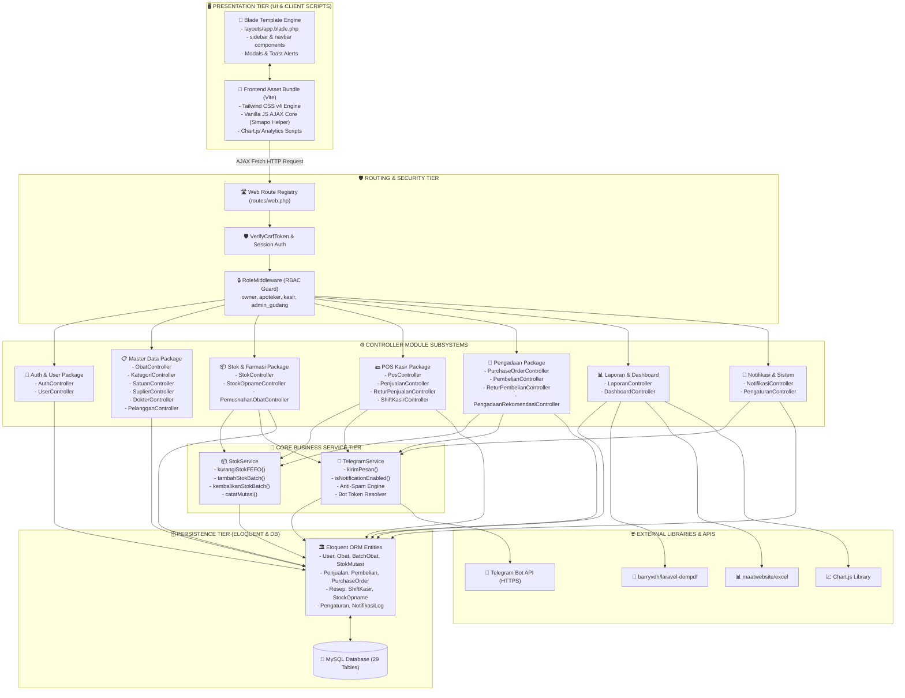

# Component & Package Diagram - SIMAPO (Apotek Bintan 88)

Dokumen ini memuat Component & Package Diagram untuk **SIMAPO (Apotek Bintan 88)** yang menggambarkan arsitektur modular perangkat lunak, pembagian paket subsistem, dan ketergantungan (*dependencies*) antar-komponen.

---

## 1. Component Diagram (Arsitektur Multi-Tier Modular)

### Diagram Mermaid

---

## 2. Deskripsi Hubungan Antar-Paket

1. **Paket POS Kasir & StokService**:
   Ketika kasir menekan tombol bayar, `PosController` memanggil `StokService::kurangiStokFEFO()` untuk memproses batch obat secara sekuensial berdasarkan tanggal kedaluwarsa terdekat.
2. **Paket Pengadaan & StokService**:
   Ketika Admin Gudang menyimpan penerimaan barang faktur, `PembelianController` memanggil `StokService::catatMutasi()` untuk menambah kuantitas batch dan mencatat kartu mutasi secara atomik di dalam `DB::transaction`.
3. **Paket Notifikasi & TelegramService**:
   Seluruh aksi penting (Void transaksi, retur penjualan, penerimaan barang, dan selisih kas shift) menginjeksi `TelegramService` untuk memeriksa status saklar konfigurasi, memfilter anti-spam, dan mengirimkan pesan HTML ke Telegram Bot API.
4. **Paket Laporan & Ekspor**:
   `LaporanController` mengintegrasikan `barryvdh/laravel-dompdf` untuk menghasilkan dokumen PDF resmi dan mengalirkan data CSV/Excel yang kompatibel dengan spreadsheet.
