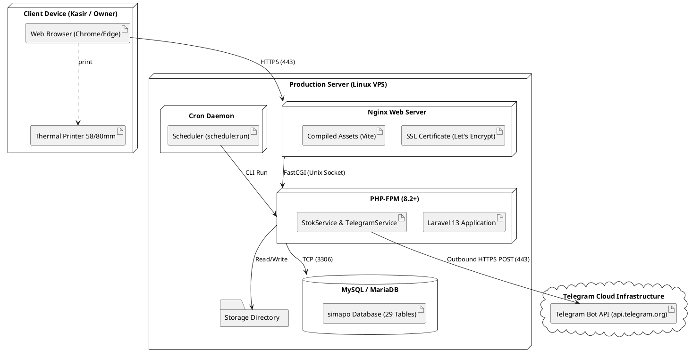

# Deployment Diagram - SIMAPO (Apotek Bintan 88)

Dokumen ini memuat Deployment Diagram untuk **SIMAPO (Apotek Bintan 88)** yang menggambarkan arsitektur fisik penyebaran (*deployment*) sistem pada server hosting/VPS Linux Ubuntu dan interaksinya dengan perangkat klien serta layanan cloud eksternal Telegram Bot API.

---

## 1. Deployment Diagram (Infrastruktur VPS & Klien)

### Diagram Mermaid

```mermaid
flowchart TB
    %% ========================================================
    %% NODE 1: PERANGKAT PENGGUNA (CLIENT TIER)
    %% ========================================================
    subgraph ClientTier ["🖥️ PERANGKAT KLIEN (CLIENT TIER)"]
        BrowserKasir["💻 PC / Tablet Kasir (Meja Depan)\n«device»\nOS: Windows / Android\nWeb Browser: Chrome / Edge / Firefox"]
        BrowserOwner["📱 Laptop / Smartphone Owner & Apoteker\n«device»\nWeb Browser & Telegram Client App"]
        PrinterKasir["🖨️ Printer Termal Kasir (58mm / 80mm)\n«peripheral»\nKoneksi: USB / ESC-POS / Direct Print"]
    end

    %% ========================================================
    %% NODE 2: PRODUCTION SERVER VPS (APPLICATION TIER)
    %% ========================================================
    subgraph VPSServer ["☁️ LINUX VPS SERVER (HOSTING / PRODUCTION)\n«executionEnvironment: Ubuntu 22.04 / 24.04 LTS»"]
        
        subgraph WebTier ["Web Server Subsystem"]
            Nginx["🌐 Nginx Web Server (Reverse Proxy & SSL)\n«component»\n- Port 80 (HTTP Redirect)\n- Port 443 (HTTPS TLS 1.3 Let's Encrypt)\n- Serves Static Assets (Vite CSS/JS)"]
        end

        subgraph AppTier ["Application Runtime Subsystem"]
            PHPFPM["⚙️ PHP 8.2+ / 8.3 FPM Process\n«executionEnvironment»\n- php-fpm.sock (FastCGI Protocol)"]
            
            subgraph LaravelApp ["Laravel 13 Application Core (/var/www/simapo)"]
                AppRouter["🛣️ HTTP Routing & RoleMiddleware"]
                Controllers["🎮 Controllers (POS, Stok, Laporan, Pengadaan)"]
                Services["🧩 StokService & TelegramService"]
                Eloquent["🗃️ Eloquent ORM (29 Data Models)"]
            end
        end

        subgraph BackgroundTier ["Background Scheduler Subsystem"]
            CronDaemon["⏰ Linux Cron Daemon (crond)\n«process»\n* * * * * php artisan schedule:run\n- 08:00 Cek Stok Menipis/Kosong\n- 08:30 Cek Expired H-30/60/90\n- 09:00 Cek Hutang Suplier\n- 21:00 Ringkasan Omzet Harian"]
        end

        subgraph DataTier ["Database & Storage Subsystem"]
            MySQLDB[("🗄️ MySQL / MariaDB Server\n«databaseSystem»\n- Port 3306 (Localhost/Socket)\n- Database: 'simapo' (29 Tables, InnoDB)\n- UTF8mb4 Unicode Collation")]
            StorageFS["📁 Local File System Storage\n«fileStorage»\n- /storage/app/public (Bukti Bayar, BAP)\n- /public/build (Vite Compiled Assets)\n- /storage/logs/laravel.log"]
        end
    end

    %% ========================================================
    %% NODE 3: EXTERNAL CLOUD SERVICES (THIRD PARTY TIER)
    %% ========================================================
    subgraph CloudServices ["🌐 EXTERNAL CLOUD SERVICES"]
        TelegramCloud["🤖 Telegram Messenger Cloud Infrastructure\n«cloudService»\n- Host: api.telegram.org\n- Protocol: HTTPS REST API (Port 443)\n- Endpoint: /bot{TOKEN}/sendMessage"]
        TelegramUsers["👥 Grup Staf Apotek & Chat Pribadi Owner\n«messagingDestination»"]
    end

    %% ========================================================
    %% NETWORK CONNECTIONS & PROTOCOLS
    %% ========================================================
    BrowserKasir -->|HTTPS / WSS (Port 443)| Nginx
    BrowserOwner -->|HTTPS (Port 443)| Nginx
    BrowserKasir -.->|Local Print Command| PrinterKasir

    Nginx -->|FastCGI Protocol (unix:/run/php/php-fpm.sock)| PHPFPM
    Nginx -->|Static File Access| StorageFS

    PHPFPM --> AppRouter
    AppRouter --> Controllers
    Controllers --> Services
    Controllers --> Eloquent

    CronDaemon -->|Artisan CLI Execution| PHPFPM

    Eloquent -->|MySQL Socket / TCP Port 3306 (PDO)| MySQLDB
    Controllers -->|File Read/Write Operations| StorageFS

    Services -->|HTTPS Outbound POST (Port 443)| TelegramCloud
    TelegramCloud -->|Push Notification| TelegramUsers
    TelegramUsers -.->|Dibaca Langsung oleh| BrowserOwner
```

---

## 2. Tabel Spesifikasi Komponen Deployment

| Node / Layer | Komponen | Peran / Fungsi | Protokol & Port |
|---|---|---|---|
| **Client** | Web Browser (Chrome/Firefox/Edge) | Menjalankan UI responsif, rendering Tailwind CSS, dan script Vanilla JS AJAX. | HTTPS (Port 443) |
| **Client** | Printer Kasir Termal 58/80mm | Mencetak struk fisik transaksi kasir melalui CSS `@media print`. | USB / Raw ESC-POS |
| **Server: Web** | Nginx Web Server | Web server garis depan: terminasi SSL TLS, proteksi header security, dan penyaji aset statis (`public/build`). | HTTP (Port 80), HTTPS (Port 443) |
| **Server: App** | PHP-FPM 8.2+ | Runtime PHP FastCGI yang mengeksekusi kerangka kerja Laravel 13 dan dependensi Composer. | FastCGI via Unix Socket |
| **Server: Framework**| Laravel 13 Engine | Menangani HTTP Routing, validasi request, RoleMiddleware (RBAC), Service logika FEFO, dan query Eloquent. | Internal PHP Execution |
| **Server: Scheduler**| Linux Cron (`crond`) | Menjalankan `php artisan schedule:run` setiap menit untuk trigger jadwal pengecekan otomatis. | Local CLI Process |
| **Server: Data** | MySQL 8.0+ / MariaDB 10.4+ | Sistem Manajemen Basis Data Relasional (RDBMS) penyimpan 29 tabel data apotek. | TCP / Socket (Port 3306) |
| **Eksternal** | Telegram Bot API | Menerima pesan HTTP REST dari apotek dan mengirimkannya ke akun/grup Telegram staf. | HTTPS REST (Port 443) |

---

## 3. PlantUML Source Code (Alternatif Ekspor ke Word)


