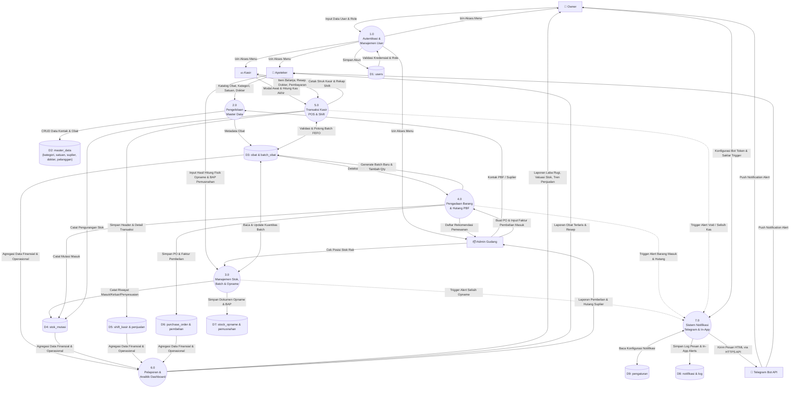

# Arsitektur Sistem & Data Flow Diagram (DFD) - SIMAPO

Dokumen ini memuat **Data Flow Diagram (DFD)** dan **Arsitektur Aliran Data Sistem** untuk **SIMAPO (Apotek Bintan 88)** yang menggambarkan bagaimana data bergerak antara entitas eksternal, proses-proses komputasi, dan penyimpan data (*data store*).

---

## 1. DFD Level 0 (Context Diagram / Diagram Konteks)

Diagram Konteks memposisikan SIMAPO sebagai satu proses sentral tunggal yang berinteraksi dengan 4 entitas eksternal manusia (**Owner**, **Apoteker**, **Kasir**, **Admin Gudang**) dan 1 entitas eksternal sistem (**Telegram Bot API**).

### Diagram Mermaid

```mermaid
flowchart LR
    %% Entitas Eksternal
    Owner["👑 Owner / Pemilik"]
    Apoteker["💊 Apoteker"]
    Kasir["💵 Kasir"]
    Gudang["📦 Admin Gudang"]
    Telegram["🤖 Telegram Bot API"]

    %% Sistem Utama
    SIMAPO(("⚙️ SIMAPO\n(Sistem Informasi\nManajemen Apotek\nBintan 88)"))

    %% Aliran Data Owner
    Owner -->|Data Akun Staf, Konfig Bot, Otorisasi Void| SIMAPO
    SIMAPO -->|Laporan Laba Rugi, Dashboard Eksekutif, Alert Kritis| Owner

    %% Aliran Data Apoteker
    Apoteker -->|Master Obat, Verifikasi Resep, Hasil Stock Opname| SIMAPO
    SIMAPO -->|Daftar Obat Expired, Laporan Stok, Notifikasi Farmasi| Apoteker

    %% Aliran Data Kasir
    Kasir -->|Data Belanja POS, Modal Shift, Rekonsiliasi Kas Akhir| SIMAPO
    SIMAPO -->|Cetak Struk Kasir, Info Stok Tersedia, Status Transaksi| Kasir

    %% Aliran Data Admin Gudang
    Gudang -->|Data PBF, Purchase Order, Faktur Pembelian, Batch & Exp| SIMAPO
    SIMAPO -->|Rekomendasi Auto-PO, Bukti Terima Barang, Kartu Stok| Gudang

    %% Aliran Data Telegram
    SIMAPO -->|Payload Pesan Format HTML (Token, Chat ID, Teks Alert)| Telegram
    Telegram -->|Response Status HTTP 200 OK / Error JSON| SIMAPO
```

---

## 2. DFD Level 1 (Diagram Alur Data Tingkat Rinci)

DFD Level 1 memecah SIMAPO menjadi 7 proses bisnis utama beserta data store (*tabel-tabel database*) yang menjadi tempat penyimpanan data permanen.

### Diagram Mermaid



---

## 3. Matriks Aliran Data Antara Entitas & Proses

| Entitas | Input ke Proses | Output dari Proses |
|---|---|---|
| **Owner** | - Kredensial login<br>- Data akun karyawan & role<br>- Pengaturan token bot Telegram<br>- Otorisasi void transaksi | - Dashboard analitik & grafik omzet<br>- Laporan laba rugi apotek<br>- Ringkasan penjualan harian via Telegram<br>- Log audit aktivitas pengguna |
| **Apoteker** | - Master data obat & aturan pakai<br>- Verifikasi resep dokter<br>- Berita acara stock opname & pemusnahan | - Alert obat expired & hampir expired<br>- Laporan penjualan obat keras beresep<br>- Rekomendasi stok menipis |
| **Kasir** | - Nominal modal awal shift<br>- Item belanja obat bebas & resep<br>- Pembayaran tunai/QRIS/transfer<br>- Input nominal fisik kas saat tutup shift | - Struk kasir termal 58/80mm<br>- Lembar rekonsiliasi kas shift<br>- Pencarian obat & cek stok |
| **Admin Gudang**| - Data Pedagang Besar Farmasi (PBF)<br>- Pengajuan Purchase Order (PO)<br>- Input faktur barang masuk (No Batch, Exp Date)<br>- Pengajuan retur suplier | - Lembar Surat Pesanan PO resmi<br>- Daftar rekomendasi pemesanan otomatis<br>- Pengingat jatuh tempo hutang suplier |
| **Telegram API**| - Response status HTTP 200 / Error JSON | - Pesan broadcast HTML (Stok kosong, expired, hutang, rekap) |
