# Entity Relationship Diagram (ERD) - SIMAPO (Apotek Bintan 88)

Dokumen ini memuat **Entity Relationship Diagram (ERD)** untuk basis data **SIMAPO (Apotek Bintan 88)** yang dibangun berdasarkan 29 tabel nyata dan relasinya di dalam database MySQL.

---

## 1. Diagram ERD (Mermaid erDiagram)

```mermaid
erDiagram
    %% ==========================================
    %% USERS & AUTHENTICATION
    %% ==========================================
    USERS ||--o{ PENJUALAN : "mencatat transaksi"
    USERS ||--o{ PEMBELIAN : "menerima faktur"
    USERS ||--o{ PURCHASE_ORDER : "membuat pesanan"
    USERS ||--o{ SHIFT_KASIR : "menjalankan shift"
    USERS ||--o{ STOK_MUTASI : "melakukan mutasi"
    USERS ||--o{ STOCK_OPNAME : "melakukan opname"
    USERS ||--o{ PEMUSNAHAN_OBAT : "penanggung jawab"
    USERS ||--o{ NOTIFIKASI : "menerima notif"
    USERS ||--o{ ACTIVITY_LOG : "merekam log"

    %% ==========================================
    %% MASTER DATA & RELATIONSHIPS
    %% ==========================================
    KATEGORI ||--o{ OBAT : "menggolongkan"
    SATUAN ||--o{ OBAT : "satuan takar"
    SUPLIER ||--o{ PURCHASE_ORDER : "tujuan pemesanan"
    SUPLIER ||--o{ PEMBELIAN : "pemasok faktur"
    SUPLIER ||--o{ BATCH_OBAT : "distributor batch"
    SUPLIER ||--o{ RETUR_PEMBELIAN : "menerima retur"

    DOKTER ||--o{ RESEP : "menerbitkan resep"
    PELANGGAN ||--o{ PENJUALAN : "melakukan pembelian"
    RESEP ||--o| PENJUALAN : "dilampirkan pada"

    %% ==========================================
    %% INVENTORY & BATCH
    %% ==========================================
    OBAT ||--o{ BATCH_OBAT : "memiliki multi-batch"
    OBAT ||--o{ STOK_MUTASI : "riwayat saldo"
    OBAT ||--o{ PENJUALAN_DETAIL : "item terjual"
    OBAT ||--o{ PEMBELIAN_DETAIL : "item dibeli"
    OBAT ||--o{ PURCHASE_ORDER_DETAIL : "item dipesan"
    OBAT ||--o{ STOCK_OPNAME_DETAIL : "item dihitung"

    BATCH_OBAT ||--o{ PENJUALAN_DETAIL : "terpotong FEFO"
    BATCH_OBAT ||--o{ PEMBELIAN_DETAIL : "dibuat saat masuk"
    BATCH_OBAT ||--o{ STOK_MUTASI : "mutasi batch"
    BATCH_OBAT ||--o{ PEMUSNAHAN_OBAT : "dimusnahkan"

    %% ==========================================
    %% TRANSAKSI PENJUALAN & RETUR
    %% ==========================================
    SHIFT_KASIR ||--o{ PENJUALAN : "mencakup transaksi"
    PENJUALAN ||--|{ PENJUALAN_DETAIL : "memiliki rincian"
    PENJUALAN ||--o{ RETUR_PENJUALAN : "diretur pelanggan"
    RETUR_PENJUALAN ||--|{ RETUR_PENJUALAN_DETAIL : "rincian retur jual"

    %% ==========================================
    %% PENGADAAN & HUTANG
    %% ==========================================
    PURCHASE_ORDER ||--|{ PURCHASE_ORDER_DETAIL : "rincian pesanan"
    PURCHASE_ORDER ||--o{ PEMBELIAN : "realisasi pesanan"
    PEMBELIAN ||--|{ PEMBELIAN_DETAIL : "rincian faktur masuk"
    PEMBELIAN ||--o{ PEMBAYARAN_HUTANG : "dicicil pelunasannya"
    PEMBELIAN ||--o{ RETUR_PEMBELIAN : "diretur ke PBF"
    RETUR_PEMBELIAN ||--|{ RETUR_PEMBELIAN_DETAIL : "rincian retur beli"

    %% ==========================================
    %% STOCK OPNAME
    %% ==========================================
    STOCK_OPNAME ||--|{ STOCK_OPNAME_DETAIL : "rincian audit fisik"

    %% ==========================================
    %% DEFINISI ATRIBUT ENTITAS
    %% ==========================================
    USERS {
        bigint id PK
        string name
        string email UK
        string password
        string role "owner, apoteker, kasir, admin_gudang"
        string telegram_chat_id
        boolean is_active
    }

    KATEGORI {
        bigint id PK
        string nama
        text deskripsi
    }

    SATUAN {
        bigint id PK
        string nama
        string deskripsi
    }

    SUPLIER {
        bigint id PK
        string nama
        string kontak_person
        string telepon
        string email
        text alamat
    }

    PELANGGAN {
        bigint id PK
        string nama
        string telepon
        text alamat
    }

    DOKTER {
        bigint id PK
        string nama
        string no_sip
        string spesialis
        string telepon
    }

    OBAT {
        bigint id PK
        string kode_obat UK
        string nama_obat
        string nama_generik
        bigint kategori_id FK
        bigint satuan_id FK
        decimal harga_beli
        decimal harga_jual
        int stok_minimum
        string lokasi_rak
        boolean butuh_resep
    }

    BATCH_OBAT {
        bigint id PK
        bigint obat_id FK
        bigint suplier_id FK
        string no_batch
        date tanggal_kedaluwarsa
        int jumlah
        decimal harga_beli
        string status "aktif, habis, expired, dimusnahkan"
    }

    STOK_MUTASI {
        bigint id PK
        bigint obat_id FK
        bigint batch_obat_id FK
        bigint user_id FK
        string jenis "masuk, keluar, penyesuaian, retur_jual, retur_beli, pemusnahan"
        int jumlah
        int saldo_sebelum
        int saldo_sesudah
        string referensi
    }

    SHIFT_KASIR {
        bigint id PK
        bigint user_id FK
        timestamp waktu_buka
        timestamp waktu_tutup
        decimal modal_awal
        decimal total_penjualan_tunai
        decimal total_penjualan_non_tunai
        decimal kas_akhir_aktual
        decimal selisih_kas
        string status "buka, tutup"
    }

    RESEP {
        bigint id PK
        string no_resep
        bigint dokter_id FK
        string nama_pasien
        int umur_pasien
        date tanggal_resep
    }

    PENJUALAN {
        bigint id PK
        string no_transaksi UK
        bigint shift_kasir_id FK
        bigint user_id FK
        bigint pelanggan_id FK
        bigint resep_id FK
        string jenis_transaksi "bebas, resep"
        decimal subtotal
        decimal diskon
        decimal total
        string metode_bayar "tunai, transfer, qris"
        decimal bayar
        decimal kembalian
        string status "selesai, void"
    }

    PENJUALAN_DETAIL {
        bigint id PK
        bigint penjualan_id FK
        bigint obat_id FK
        bigint batch_obat_id FK
        int jumlah
        decimal harga_beli
        decimal harga_jual
        decimal subtotal
    }

    PURCHASE_ORDER {
        bigint id PK
        string no_po UK
        bigint suplier_id FK
        bigint user_id FK
        date tanggal
        date estimasi_tanggal
        decimal total_estimasi
        string status "draft, dipesan, diterima_sebagian, diterima, batal"
    }

    PURCHASE_ORDER_DETAIL {
        bigint id PK
        bigint purchase_order_id FK
        bigint obat_id FK
        int jumlah_pesan
        int jumlah_diterima
        decimal harga_satuan
        decimal subtotal
    }

    PEMBELIAN {
        bigint id PK
        string no_faktur
        bigint purchase_order_id FK
        bigint suplier_id FK
        bigint user_id FK
        date tanggal
        decimal total
        string jenis_bayar "tunai, kredit"
        string status_bayar "lunas, belum_lunas"
        date jatuh_tempo
        decimal sisa_hutang
    }

    PEMBELIAN_DETAIL {
        bigint id PK
        bigint pembelian_id FK
        bigint obat_id FK
        bigint batch_obat_id FK
        int jumlah
        decimal harga_beli
        decimal subtotal
    }

    PEMBAYARAN_HUTANG {
        bigint id PK
        bigint pembelian_id FK
        bigint user_id FK
        date tanggal
        decimal jumlah_bayar
        string metode "tunai, transfer"
    }

    STOCK_OPNAME {
        bigint id PK
        string no_opname UK
        bigint user_id FK
        date tanggal
        string status "draft, selesai"
    }

    STOCK_OPNAME_DETAIL {
        bigint id PK
        bigint stock_opname_id FK
        bigint obat_id FK
        bigint batch_obat_id FK
        int stok_sistem
        int stok_fisik
        int selisih
    }

    PEMUSNAHAN_OBAT {
        bigint id PK
        string no_pemusnahan UK
        bigint obat_id FK
        bigint batch_obat_id FK
        bigint user_id FK
        date tanggal
        int jumlah
        text alasan
        string penanggung_jawab
    }

    PENGATURAN {
        bigint id PK
        string key UK
        text value
        string tipe
        string keterangan
    }

    NOTIFIKASI_LOG {
        bigint id PK
        string jenis
        text pesan
        string tujuan
        string status "terkirim, gagal"
        text response_error
        timestamp waktu
    }
```

