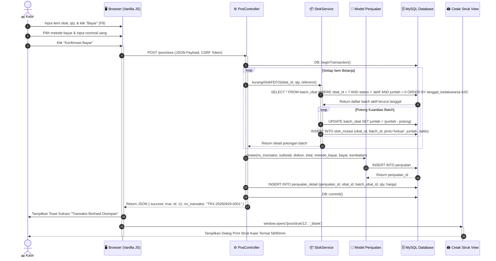
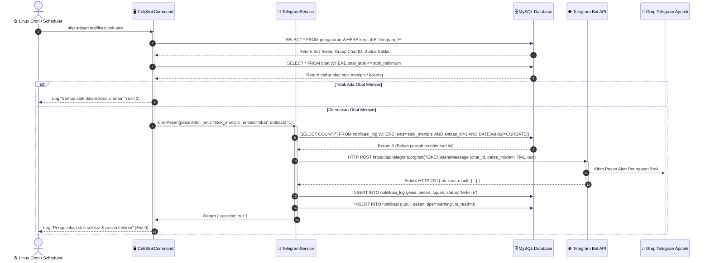
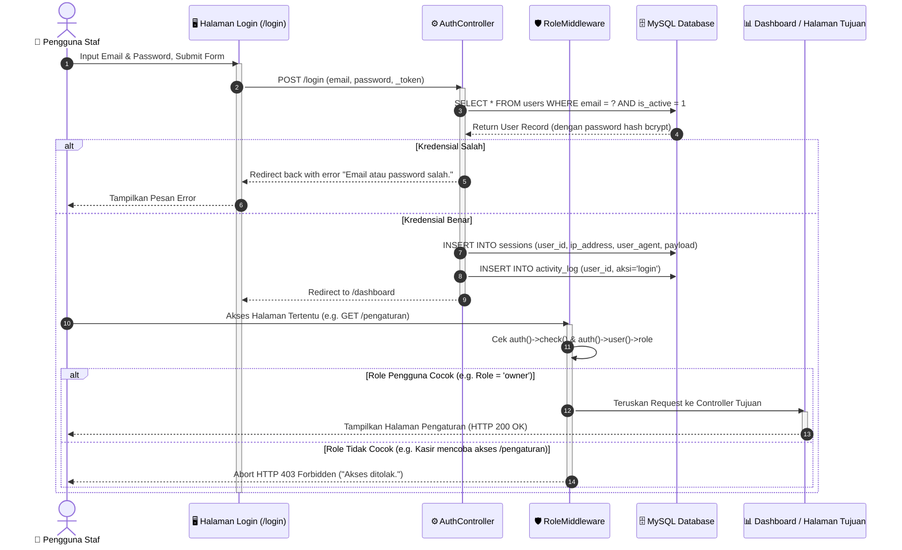
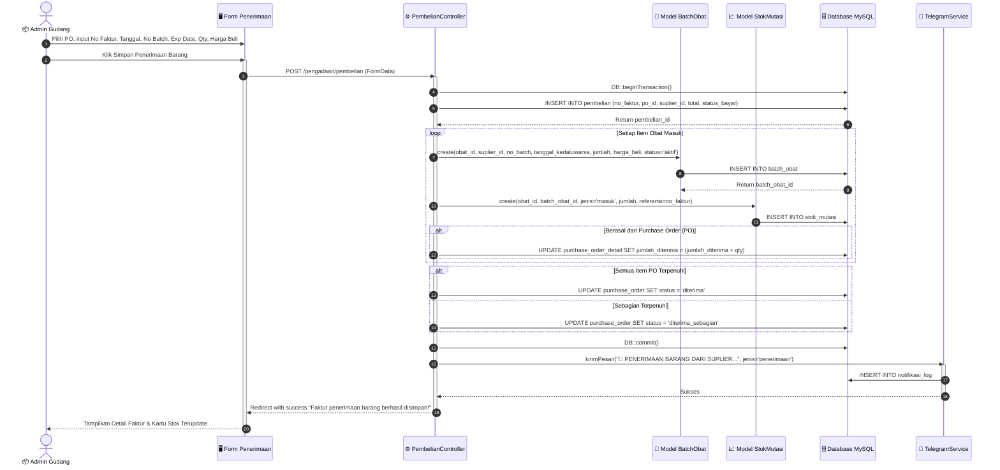
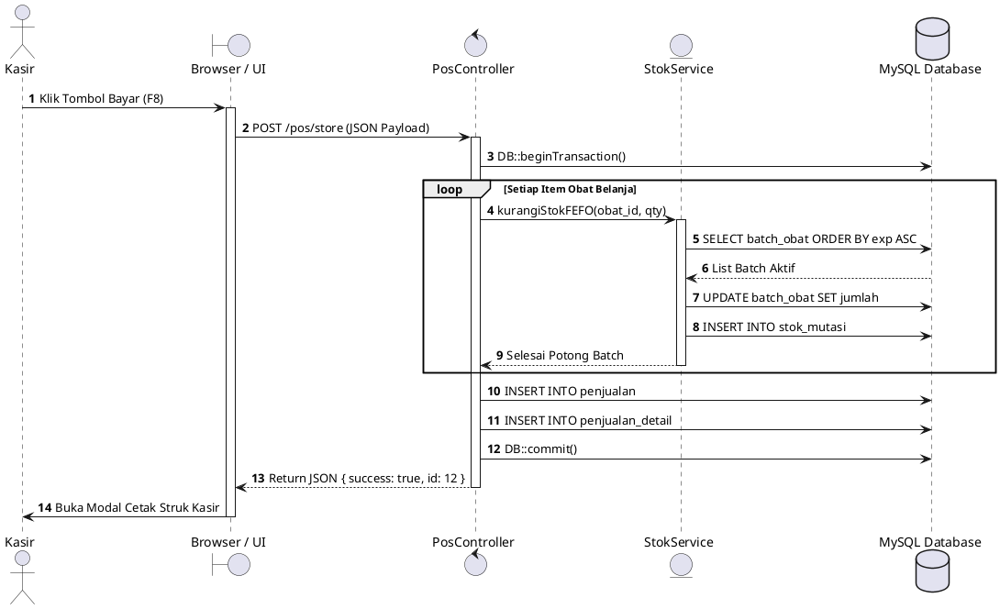

# Sequence Diagram - SIMAPO (Apotek Bintan 88)

Dokumen ini memuat Sequence Diagram untuk **SIMAPO (Apotek Bintan 88)** yang menggambarkan kronologi pesan dan interaksi antar komponen (*User*, *Browser/View*, *Controller*, *Service*, *Model/Eloquent*, *Database*, dan *External API*).

---

## 1. Sequence Diagram: Transaksi Penjualan POS Kasir (Metode FEFO & Cetak Struk)

Menggambarkan alur eksekusi saat kasir menyelesaikan transaksi belanja obat di kasir POS satu layar menggunakan Vanilla JS Fetch AJAX, validasi resep, kalkulasi FEFO, transaksi database atomik, dan pencetakan struk kasir termal.

### Diagram Mermaid

---

## 2. Sequence Diagram: Pengecekan Otomatis & Notifikasi Telegram (Scheduler Cron)

Menggambarkan alur kerja cron job Laravel yang berjalan terjadwal di latar belakang (*background job*), mengeksekusi Artisan Command, mengecek stok kosong/menipis, memfilter anti-spam, memanggil Telegram Bot API, dan mencatat log transmisi pesan.

### Diagram Mermaid

---

## 3. Sequence Diagram: Autentikasi Login & Otorisasi Hak Akses (RoleMiddleware)

Menggambarkan alur login pengguna, pembuatan sesi terenkripsi, pencegatan URL langsung oleh `RoleMiddleware`, dan pengalihan jika pengguna tidak memiliki izin (HTTP 403).

### Diagram Mermaid

---

## 4. Sequence Diagram: Penerimaan Barang & Pembuatan Batch Baru

Menggambarkan interaksi saat Admin Gudang menerima barang dari suplier, mencatat faktur, membuat batch obat baru, memperbarui saldo kartu stok, dan mengupdate status Purchase Order (PO).

### Diagram Mermaid

---

## 5. PlantUML Source Code (Alternatif Ekspor ke Word)

