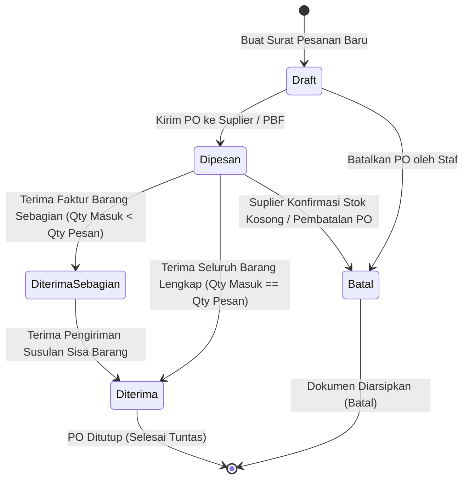
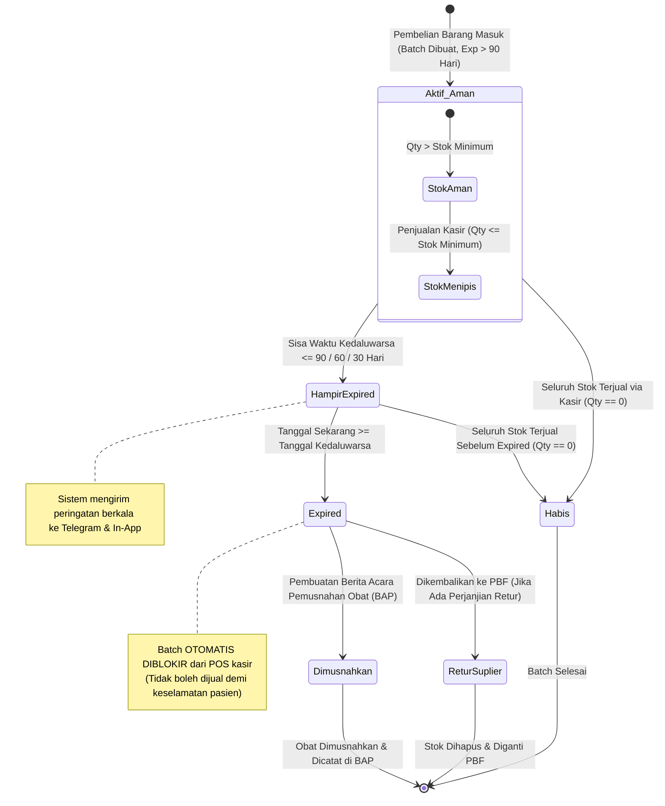
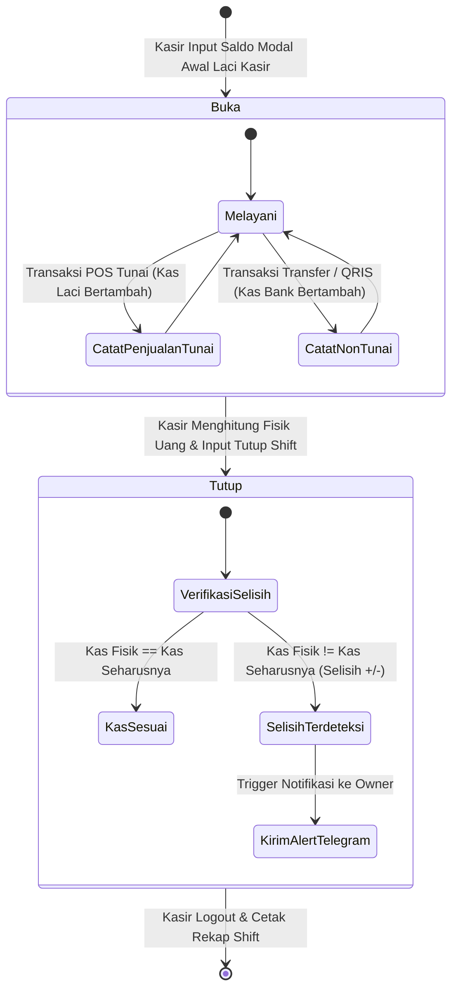
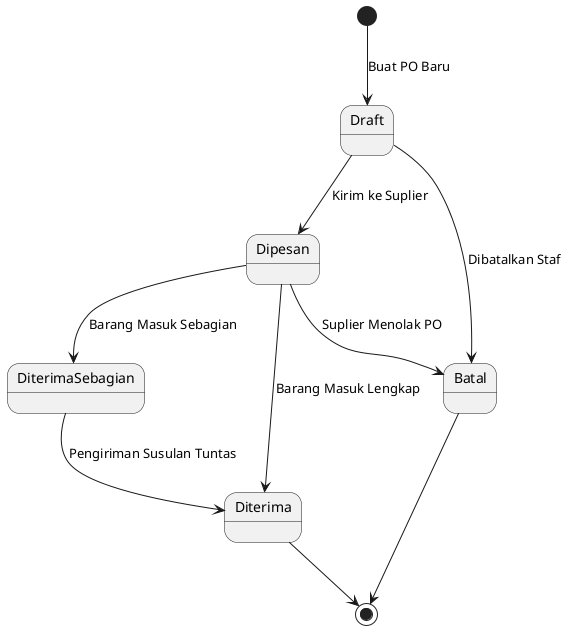

# State Machine Diagram - SIMAPO (Apotek Bintan 88)

Dokumen ini memuat State Machine Diagram untuk siklus hidup entitas penting pada **SIMAPO (Apotek Bintan 88)**, yaitu:
1. **Siklus Hidup Status Purchase Order (PO)**
2. **Siklus Hidup Status Batch Obat & Kedaluwarsa**
3. **Siklus Hidup Status Shift Kasir**

---

## 1. State Machine Diagram: Siklus Status Purchase Order (PO)

Menggambarkan transisi status dokumen Purchase Order dari saat dirancang sebagai draft hingga barang diterima tuntas di gudang apotek atau dibatalkan.

### Diagram Mermaid

---

## 2. State Machine Diagram: Siklus Hidup Batch Obat (Status & Kedaluwarsa)

Menggambarkan transisi status dan kondisi fisik batch obat di rak apotek, mulai dari penerimaan faktur pembelian, penjualan FEFO, status kedaluwarsa, hingga pemusnahan resmi.

### Diagram Mermaid

---

## 3. State Machine Diagram: Siklus Status Shift Kasir

Menggambarkan peralihan status kerja kasir dari pembukaan laci kasir hingga rekonsiliasi tutup buku.

### Diagram Mermaid

---

## 4. PlantUML Source Code (Alternatif Ekspor ke Word)

