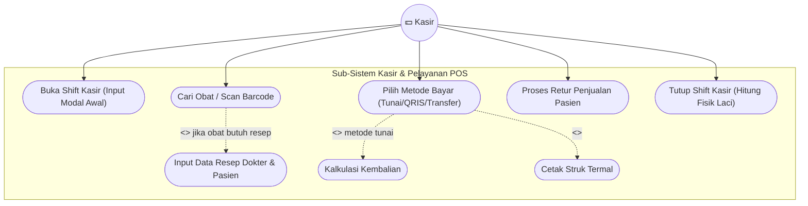
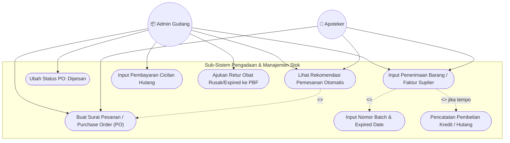
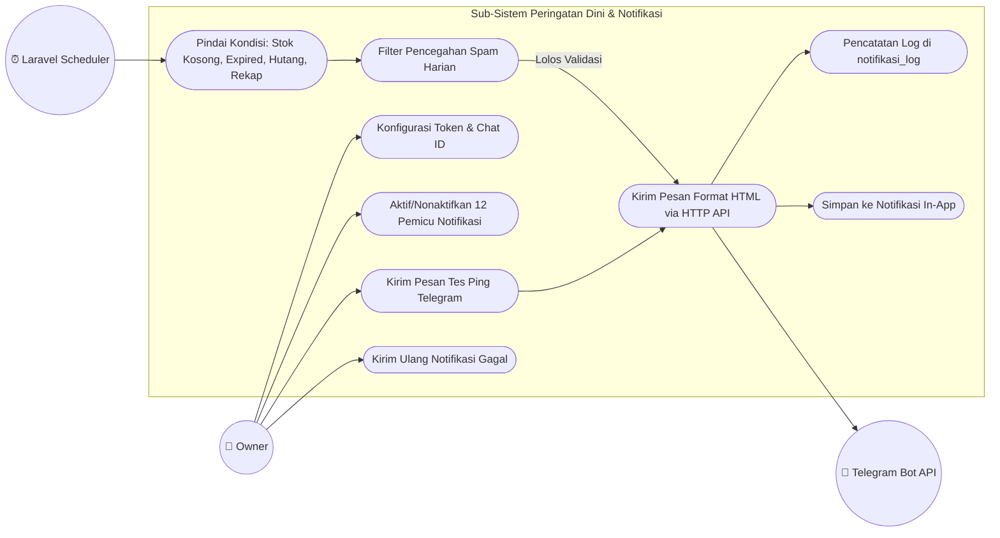
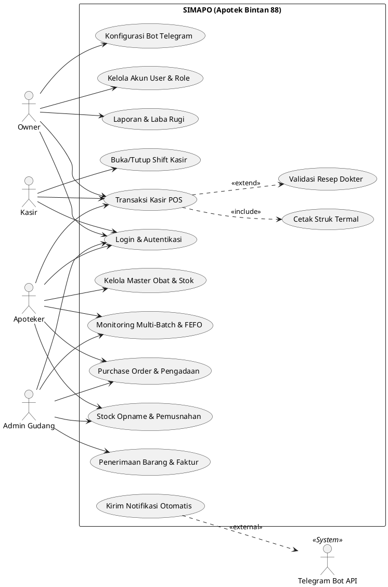

# Use Case Diagram - SIMAPO (Apotek Bintan 88)

Dokumen ini memuat Use Case Diagram untuk **SIMAPO (Sistem Informasi Manajemen Apotek Bintan 88)** yang dirancang berdasarkan implementasi nyata sistem. Diagram ini dapat dirender langsung menggunakan Markdown viewer (seperti GitHub/VS Code) atau disalin ke [Mermaid Live Editor](https://mermaid.live) / [PlantText](https://www.planttext.com) untuk diekspor menjadi gambar resolusi tinggi (PNG/SVG) ke dalam laporan Microsoft Word.

---

## 1. Use Case Diagram Utama (Sistem Keseluruhan)

Diagram ini menggambarkan interaksi antara 4 aktor internal pengguna apotek (**Owner**, **Apoteker**, **Kasir**, **Admin Gudang**) dan 1 aktor eksternal sistem (**Telegram Bot API**).

### Diagram Mermaid

```mermaid
flowchart LR
    %% Aktor Internal & Eksternal
    subgraph Aktor ["Aktor Pengguna"]
        Owner(("👑 Owner"))
        Apoteker(("💊 Apoteker"))
        Kasir(("💵 Kasir"))
        Gudang(("📦 Admin Gudang"))
        Telegram(("🤖 Telegram Bot API"))
    end

    %% Batasan Sistem Apotek
    subgraph SIMAPO ["SISTEM INFORMASI MANAJEMEN APOTEK (SIMAPO)"]
        %% Modul Autentikasi & Akun
        UC_Login(["UC-01 Login & Logout"])
        UC_Profile(["UC-02 Kelola Profil & Chat ID"])
        UC_Users(["UC-03 Manajemen User & Role"])
        
        %% Modul Master Data
        UC_MasterObat(["UC-04 Kelola Master Obat"])
        UC_MasterKategoriSatuan(["UC-05 Kelola Kategori & Satuan"])
        UC_MasterSuplier(["UC-06 Kelola Data Suplier"])
        UC_MasterDokter(["UC-07 Kelola Data Dokter"])
        UC_MasterPelanggan(["UC-08 Kelola Data Pelanggan"])

        %% Modul Stok & Farmasi
        UC_MonitoringStok(["UC-09 Monitoring Stok & Multi-Batch"])
        UC_KartuStok(["UC-10 Lihat Kartu Mutasi Stok"])
        UC_StockOpname(["UC-11 Pelaksanaan Stock Opname"])
        UC_Pemusnahan(["UC-12 Pemusnahan Obat Kedaluwarsa"])

        %% Modul Pengadaan
        UC_RekomendasiPO(["UC-13 Rekomendasi Pemesanan Otomatis"])
        UC_PurchaseOrder(["UC-14 Kelola Purchase Order (PO)"])
        UC_PenerimaanBarang(["UC-15 Penerimaan Pembelian & Batch Baru"])
        UC_HutangSuplier(["UC-16 Kelola & Bayar Hutang Suplier"])
        UC_ReturBeli(["UC-17 Kelola Retur Pembelian"])

        %% Modul POS Kasir
        UC_ShiftKasir(["UC-18 Kelola Shift Kasir (Buka/Tutup)"])
        UC_TransaksiBebas(["UC-19 Transaksi Penjualan Bebas"])
        UC_TransaksiResep(["UC-20 Transaksi Penjualan Resep"])
        UC_CetakStruk(["UC-21 Cetak Struk Termal"])
        UC_Void(["UC-22 Pembatalan Transaksi (VOID)"])
        UC_ReturJual(["UC-23 Kelola Retur Penjualan Pasien"])

        %% Modul Laporan & Dashboard
        UC_Dashboard(["UC-24 Monitoring Dashboard Analitik"])
        UC_LaporanPenjualan(["UC-25 Laporan Penjualan & Resep"])
        UC_LaporanStokExpired(["UC-26 Laporan Stok & Kedaluwarsa"])
        UC_LaporanPembelian(["UC-27 Laporan Pembelian & Hutang"])
        UC_LaporanLabaRugi(["UC-28 Laporan Laba Rugi"])
        UC_ActivityLog(["UC-29 Audit Trail / Log Aktivitas"])

        %% Modul Notifikasi & Sistem
        UC_PengaturanNotif(["UC-30 Pengaturan Sistem & Bot Token"])
        UC_TesTelegram(["UC-31 Uji Kirim Pesan Tes Telegram"])
        UC_InAppNotif(["UC-32 Monitoring Notifikasi In-App"])
        UC_KirimNotifAuto(["UC-33 Pengiriman Notifikasi Otomatis"])
    end

    %% Relasi Aktor Owner
    Owner --> UC_Login
    Owner --> UC_Profile
    Owner --> UC_Users
    Owner --> UC_Dashboard
    Owner --> UC_MasterObat
    Owner --> UC_MonitoringStok
    Owner --> UC_StockOpname
    Owner --> UC_Void
    Owner --> UC_LaporanPenjualan
    Owner --> UC_LaporanStokExpired
    Owner --> UC_LaporanPembelian
    Owner --> UC_LaporanLabaRugi
    Owner --> UC_ActivityLog
    Owner --> UC_PengaturanNotif
    Owner --> UC_TesTelegram
    Owner --> UC_InAppNotif

    %% Relasi Aktor Apoteker
    Apoteker --> UC_Login
    Apoteker --> UC_Profile
    Apoteker --> UC_Dashboard
    Apoteker --> UC_MasterObat
    Apoteker --> UC_MasterKategoriSatuan
    Apoteker --> UC_MasterDokter
    Apoteker --> UC_MonitoringStok
    Apoteker --> UC_KartuStok
    Apoteker --> UC_StockOpname
    Apoteker --> UC_Pemusnahan
    Apoteker --> UC_RekomendasiPO
    Apoteker --> UC_PurchaseOrder
    Apoteker --> UC_PenerimaanBarang
    Apoteker --> UC_TransaksiBebas
    Apoteker --> UC_TransaksiResep
    Apoteker --> UC_Void
    Apoteker --> UC_LaporanPenjualan
    Apoteker --> UC_LaporanStokExpired
    Apoteker --> UC_InAppNotif

    %% Relasi Aktor Kasir
    Kasir --> UC_Login
    Kasir --> UC_Profile
    Kasir --> UC_ShiftKasir
    Kasir --> UC_TransaksiBebas
    Kasir --> UC_TransaksiResep
    Kasir --> UC_CetakStruk
    Kasir --> UC_ReturJual
    Kasir --> UC_MasterPelanggan
    Kasir --> UC_InAppNotif

    %% Relasi Aktor Admin Gudang
    Gudang --> UC_Login
    Gudang --> UC_Profile
    Gudang --> UC_Dashboard
    Gudang --> UC_MasterSuplier
    Gudang --> UC_MonitoringStok
    Gudang --> UC_KartuStok
    Gudang --> UC_StockOpname
    Gudang --> UC_RekomendasiPO
    Gudang --> UC_PurchaseOrder
    Gudang --> UC_PenerimaanBarang
    Gudang --> UC_HutangSuplier
    Gudang --> UC_ReturBeli
    Gudang --> UC_LaporanPembelian
    Gudang --> UC_LaporanStokExpired
    Gudang --> UC_InAppNotif

    %% Relasi Sistem dengan Aktor Eksternal Telegram
    UC_KirimNotifAuto -.-> Telegram
    UC_TesTelegram -.-> Telegram
    
    %% Relasi <<include>> dan <<extend>>
    UC_TransaksiBebas -.->|<<include>>| UC_CetakStruk
    UC_TransaksiResep -.->|<<include>>| UC_CetakStruk
    UC_Void -.->|<<extend>>| UC_TransaksiBebas
    UC_RekomendasiPO -.->|<<extend>>| UC_PurchaseOrder
    UC_PurchaseOrder -.->|<<include>>| UC_PenerimaanBarang
```

---

## 2. Use Case Diagram Khusus: Role Kasir (POS & Shift)

Diagram ini mengkhususkan alur operasional kasir dari saat membuka shift kerja hingga penutupan kasir.

---

## 3. Use Case Diagram Khusus: Pengadaan & Logistik (Admin Gudang & Apoteker)

Diagram ini menggambarkan alur pengadaan obat mulai dari deteksi stok kritis sampai pencatatan batch baru dan hutang.

---

## 4. Use Case Diagram Khusus: Sistem Notifikasi Telegram (Owner & Sistem)

---

## 5. PlantUML Source Code (Alternatif Ekspor ke Word)

Bila Anda lebih menyukai sintaks PlantUML untuk diekspor di [PlantText](https://www.planttext.com):

